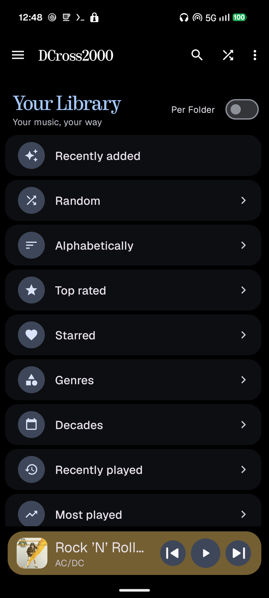
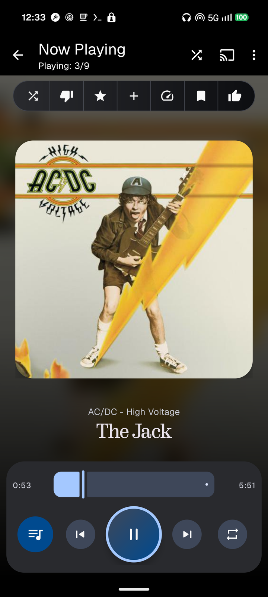
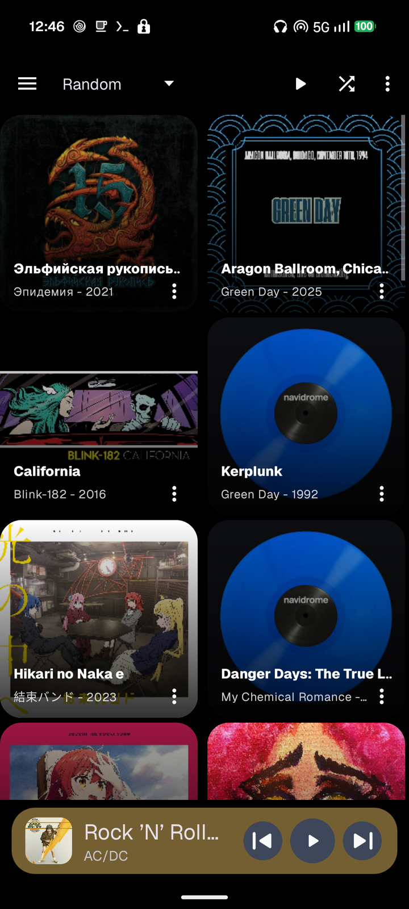
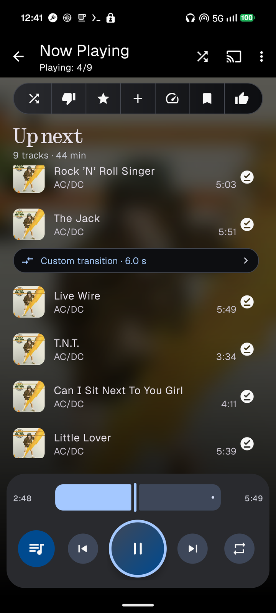
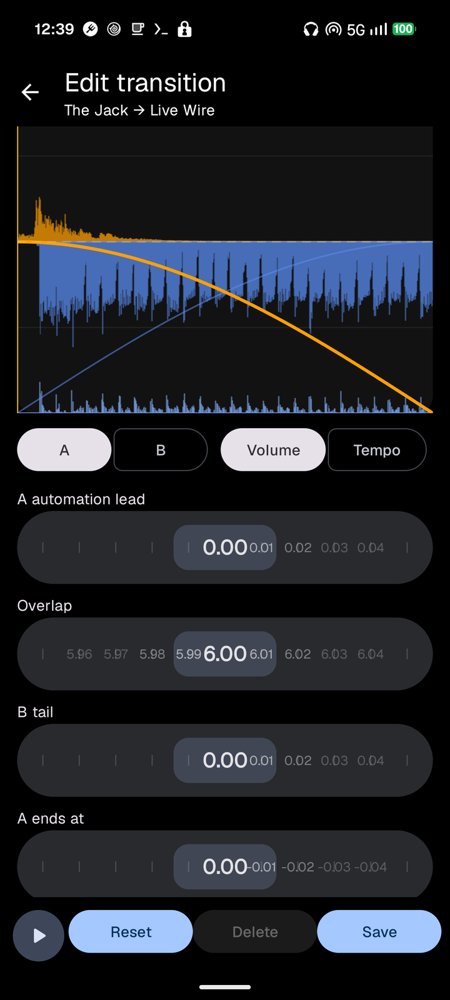

# 🚨 DCross2000 — VIBECODED, UNSTABLE, USE AT YOUR OWN RISK 🚨

> ## THIS PROJECT WAS WRITTEN BY AN AI ("VIBECODED").
>
> **It is not production software. It is an experiment.**
>
> - 💥 **Expect crashes, freezes, broken playback and lost data.**
> - 🔊 **Expect audio glitches, clipping, skipped tracks and wrong timing.**
> - 🗑️ **Transitions are stored in app-private preferences. There is no export yet. Updating or uninstalling can lose them.**
> - 🔥 **Do not use this as your only music player. Do not install it on a device you depend on.**
> - 🧪 **The transition engine uses two decoders at once. It is heavy on battery and may misbehave on low-end devices.**
> - 🚫 **No support. No warranty. No promise that anything here is correct.**
> - 🧬 **Not affiliated with Subsonic, DSub, DSub2000, or their authors.**
>
> This is a **fork of [DSub2000](https://github.com/paroj/DSub2000)** (GPLv3), renamed and modified. The upstream project is stable software; this fork is not. If you want a reliable Subsonic client, **use the upstream app instead**.

---

DCross2000 is an Android client for [Subsonic](https://www.subsonic.org/) servers with an added **per-song transition editor**: you draw the volume and tempo curves for a specific pair of tracks and the player applies them when those two songs play back to back.

## Screenshots

| Home | Now Playing |
|:---:|:---:|
|  |  |
| **Library** | **Queue with a per-pair transition** |
|  |  |

**Transition editor**



## The transition editor

- Transitions are keyed by **song pair**, not by playlist position. Reordering a queue keeps them attached to the right two tracks.
- Timing is split into three sections:
  - **Lead** — only the outgoing song is automated (e.g. dip the volume or slow it down before the next track appears).
  - **Overlap** — both songs sound; both curves apply.
  - **Tail** — only the incoming song is automated before normal playback resumes.
- Extra placement controls: **A ends at −…** stops the outgoing track before its natural end (annoying outros, silence) and **B starts at …** picks the entry point in the incoming track.
- Each side has a **volume curve** (0–2×, so quiet tracks can be boosted to normalize them) and a **tempo curve** (0.5×–1.5×, pitch-preserving).
- One zoomed view shows **two waveforms per track** — a low band for kicks/bass and an onset-emphasised high band for snares/hats — plus all four curves. Pick **A/B** and **Volume/Tempo** and draw with the pencil; Preview plays the actual overlap with a smooth, audio-locked playhead.
- Timing is changed with **snapping wheels**: drag horizontally for fast moves, vertically for 10 ms precision.
- Transitions require both songs to be cached; streaming tracks and cast/DLNA outputs ignore them.
- Default behavior without a drawn transition is plain **gapless** playback, exactly like upstream.

Where to find it:

- Playlist → **⋮ → Transitions**, or
- Now Playing → **⋮ → Transitions** (current song → next song).

## UI redesign

The fork rebuilds the interface around Material 3 Expressive instead of the upstream Holo-era look:

- **Serif headings** everywhere (NType82 from the system fonts when present, serif fallback). Geist/Inter remains the body sans.
- **Now Playing** uses a blurred artwork backdrop with a surface scrim, a square rounded cover, a tight title block and a rounded control panel. The play button is a large ringed tonal circle; the queue toggle is a prominent primary-container button.
- **Persistent action pill** — the small actions (shuffle, rating, star, add, speed, bookmark) sit in a floating segmented pill below the top bar and never fade away.
- **Queue as a first-class surface** — serif “Up next” headline with track count and duration, a tonal highlight on the playing row, and Spotify-style transition strips between mixed tracks that open the editor.
- **Floating mini player** — an artwork-tinted card that hovers above the navigation bar instead of merging with it.
- **Artist library** — circular artwork served by Navidrome/Subsonic, with per-artist caching, placeholders and scroll-aware loading.
- **Transition editor** — real low/high-band waveforms at 10 ms resolution, snapping wheels for timing, and a playhead that stays locked to the audio.

## Build

```bash
export ANDROID_HOME=/path/to/android-sdk
./gradlew :app:assembleFlossDebug
```

The debug APK is at `app/build/outputs/apk/floss/debug/`.

The application id is `com.proggerx.dcross2000`, so this installs **alongside** the original DSub2000 and starts with empty settings.

## License and attribution

DCross2000 is a fork of DSub2000 by [paroj](https://github.com/paroj/DSub2000), which is itself based on DSub by Sindre Mehus and Scott Jackson. It is licensed under the **GNU GPLv3** — see [LICENSE.txt](LICENSE.txt). The upstream commit history is preserved in this fork.

The original project has no relationship with this fork and does not endorse it.
